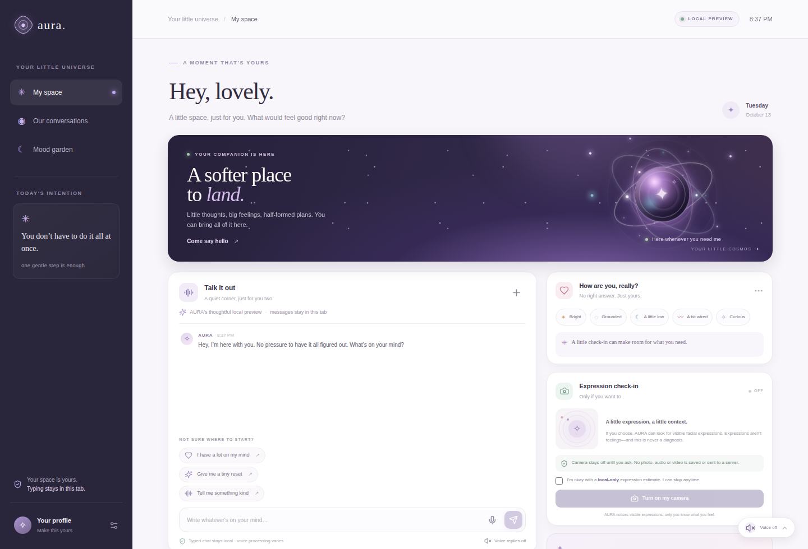
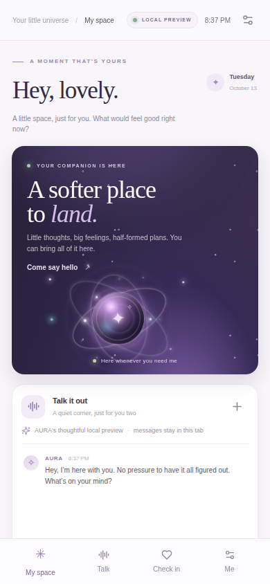

# AURA — Your Galaxy Companion

AURA is a responsive, installable Progressive Web App for gentle check-ins, a local companion chat, and an optional, consent-first expression check. One web experience can be installed from compatible mobile and desktop browsers. It is **not** a signed native Android/iOS/Windows/macOS package.

## Screenshots

**Desktop**

**Mobile**

## Run locally

- `pnpm install` — install dependencies.
- `pnpm dev:static` — start the Vite app (default port 3000).
- `pnpm check` — type-check the client and Vite configuration.
- `pnpm build:static` — build the static site into `dist/public/`.

The build copies the MediaPipe WebAssembly runtime from the installed package into the same-origin public assets. The face-landmarker model is included in `client/public/mediapipe/`.

## What it does

- A softly animated galaxy core with listening/thinking/speaking states.
- Text chat with a small set of supportive **local rule-based** replies.
- Manual mood check-ins, plus an optional camera-based visible-expression estimate.
- Opt-in browser speech input and output where supported.
- Personalization and optional browser-local settings.
- Responsive PWA shell, install icons, and a service worker.

## Privacy and limitations

The camera is off on arrival. A visitor must read and accept the notice, explicitly start the camera, and approve the browser permission. AURA requests video only; the MediaPipe expression model runs on-device. It estimates visible facial-expression cues, which are **not** proof of someone’s feelings, a clinical inference, or a diagnosis. Video is not uploaded or retained by AURA. Manual check-ins remain available without camera access.

Chat replies are local templates, not generative AI or an LLM-backed real-time service. Conversation context lasts for the page session. Preferences are saved in local browser storage only when the user opts in. Browser speech recognition may involve browser/provider services; on-device speech recognition is not promised. AURA is a supportive prototype, not mental-health care.

## Website promo video

A 30-second branded promo is available at `client/public/aura-website-promo-30s.mp4` for use on the website.

## Third-party assets

The MediaPipe Vision Tasks runtime is distributed under Apache-2.0; see `THIRD_PARTY_NOTICES.txt`. The Face Landmarker model is sourced from the official Google MediaPipe model distribution; review its accompanying notices and terms before redistribution or commercial use.
