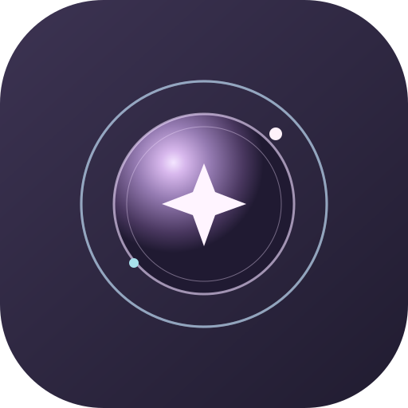

<div align="center">
  
  <h1>AURA — Your Galaxy Companion</h1>
  <p><strong>A softer place to land.</strong></p>
  <p>A calm, galaxy-inspired companion prototype for thoughtful check-ins, gentle conversation, and moments of reflection.</p>
  <p>
    
    
    
    
  </p>
</div>

---

## About AURA

AURA is a responsive, installable web app designed to feel like a personal little cosmos. Its animated galaxy core reacts to interaction while the dashboard brings together a conversation space, manual mood check-ins, and an optional camera-based **visible-expression estimate**.

AURA is intentionally a **local-first prototype**. Its chat uses a small set of supportive, rule-based replies; it is not connected to a generative AI service. Camera-based cues are estimates of visible facial expressions—not proof of a person’s feelings.

## Screenshots

### Desktop


### Mobile


## Highlights

- **A living galaxy interface** — a softly animated core responds to listening, thinking, speaking, and mood states.
- **Gentle conversation** — message prompts and local response templates offer a low-pressure place to reflect.
- **Manual mood check-ins** — choose a mood directly; camera access is never required.
- **Optional expression check-in** — after the on-screen notice, explicit consent, and browser permission, MediaPipe estimates visible-expression cues on the device.
- **Voice, where supported** — optional browser speech input and text-to-speech output.
- **Personalization by choice** — name, interests, style, voice, and atmosphere can be saved in this browser only when the user opts in.
- **Installable PWA** — responsive layouts, app icons, a web manifest, and a service worker support installation in compatible browsers.

## Getting started

### Requirements

- Node.js 22 or later
- pnpm 11.25.0 (the project’s `packageManager` version)

### Install and run

```bash
pnpm install
pnpm dev:static
```

Open **http://localhost:3000** in a modern browser. Camera check-in requires a secure context—use `localhost` for local development or HTTPS after deployment—and a browser that supports the required camera APIs.

### Validate and build

```bash
pnpm check
pnpm build:static
```

The static production site is written to `dist/public/`. The build script stages the installed MediaPipe WebAssembly runtime into the public assets so the optional expression check can use same-origin files.

## Project structure

```text
client/
├── index.html
├── public/
│   ├── aura-mark.svg
│   ├── aura-192.png, aura-512.png, apple-touch-icon.png
│   ├── manifest.webmanifest
│   ├── sw.js
│   ├── aura-website-promo-30s.mp4
│   └── mediapipe/                 # On-device model and generated WASM runtime
└── src/
    ├── components/
    │   ├── CameraMood.tsx         # Consent-first camera check-in
    │   ├── GalaxyCore.tsx         # Animated companion core
    │   └── SettingsPanel.tsx       # Local personalization
    ├── pages/Home.tsx             # Responsive companion dashboard
    ├── types/companion.ts
    ├── index.css
    └── main.tsx
scripts/copy-mediapipe.mjs        # Stages the MediaPipe WASM files
vite.config.ts
```

## Privacy and product boundaries

AURA aims to keep sensing explicit and the product’s boundaries clear:

- **Camera starts off.** The person must read the notice, check the consent box, choose the camera action, and grant the browser permission. AURA requests video only.
- **Expression cues stay limited.** MediaPipe runs on-device and estimates visible cues such as smile-like or neutral-looking expressions. These cues do not reliably reveal how someone feels and are not clinical or diagnostic assessments. A person’s own check-in takes precedence.
- **No AURA chat backend.** Replies are selected from local templates. Conversation context lasts for the current page session; it is not sent to an AURA account or cloud conversation service.
- **Preferences are opt-in.** Settings are stored in browser local storage only when “Remember these settings on this device” is enabled. AURA does not sync preferences or mood history across devices.
- **Speech depends on the browser.** Speech features are optional and use browser APIs. Speech recognition may involve the browser/provider’s own processing; AURA does not promise that recognized audio stays on-device.
- **Not care or crisis support.** AURA is a supportive prototype, not mental-health care, diagnosis, or an emergency service.

## Install AURA

AURA is a Progressive Web App rather than a signed native application package. On a deployed HTTPS site, installation is available through supported browsers:

- **Android:** open the site in a compatible browser and choose **Install app** or **Add to Home screen**.
- **iPhone or iPad:** open the site in Safari, tap **Share**, then choose **Add to Home Screen**.
- **Windows and macOS:** use the browser’s **Install** option where supported.

Availability and offline behavior vary by browser. Browser speech recognition is not guaranteed to work offline. This project does **not** include Play Store, App Store, Windows-installer, or macOS-installer packages.

## Website promo

A 30-second, 16:9 website promo is included at [`client/public/aura-website-promo-30s.mp4`](client/public/aura-website-promo-30s.mp4). It can be previewed or added to a page as a video asset.

## Technology

React · TypeScript · Vite · Tailwind CSS · MediaPipe Tasks Vision · Lucide

## Third-party notices and license

The MediaPipe Tasks Vision runtime is distributed under Apache-2.0. The Face Landmarker model is sourced from Google’s official MediaPipe model distribution. See [`THIRD_PARTY_NOTICES.txt`](THIRD_PARTY_NOTICES.txt) for provenance and notes, and review the applicable third-party terms before redistribution or commercial use. Project code is provided under the [MIT License](LICENSE).
